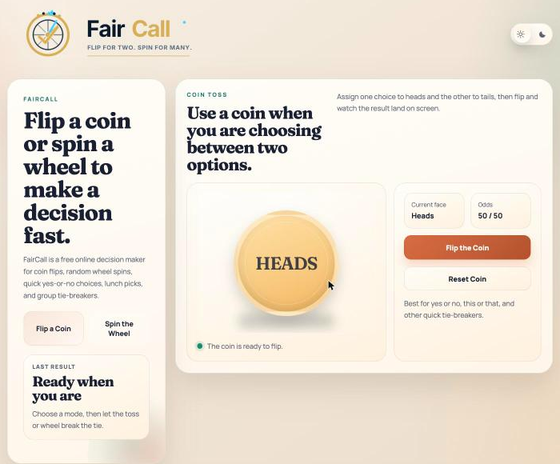
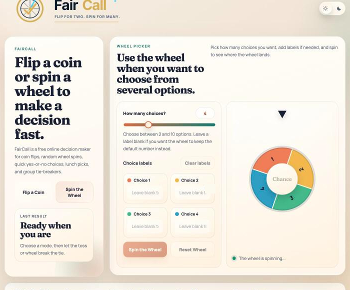

<p align="center">
  
  
</p>

<p align="center">
  <b>Flip for two. Spin for many.</b><br>
  <a href="https://amatya27.github.io/faircall/"><b>Open FairCall</b></a> &nbsp;·&nbsp; free, no sign-up, works on your phone
</p>

<p align="center">
  
  
</p>

FairCall is a small web app for settling quick decisions. Choosing between two things? Flip the coin. Choosing between more? Put up to 10 options on the wheel, give them names if you like, and spin.

## Features

- **Coin toss** with a flip animation, for yes/no and this-or-that calls.
- **Wheel picker** for 2 to 10 options, with optional labels. The wheel redraws as you type.
- **Fair randomness:** results come from `crypto.getRandomValues`, the browser's cryptographic random generator, with rejection sampling so no option is even slightly favoured (no modulo bias). `Math.random` is only a fallback.
- **Light and dark theme**, and it remembers your theme and last mode.
- **Accessible:** keyboard navigation between modes, screen-reader labels, and it respects "reduce motion" settings.
- **Installable** as a web app (web manifest), with a sitemap and robots.txt for search.

## Built with

Plain HTML, CSS and JavaScript, no framework and no build step. The wheel is drawn on a `<canvas>` with `requestAnimationFrame`, and it's hosted on GitHub Pages.

## Run it locally

```bash
git clone https://github.com/Amatya27/faircall
cd faircall
python -m http.server 8000   # then open http://localhost:8000
```
